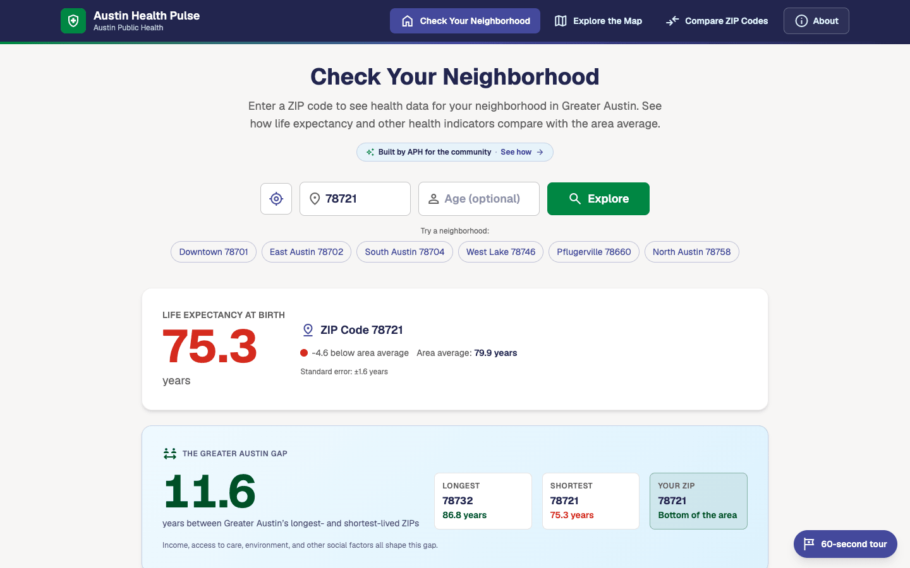
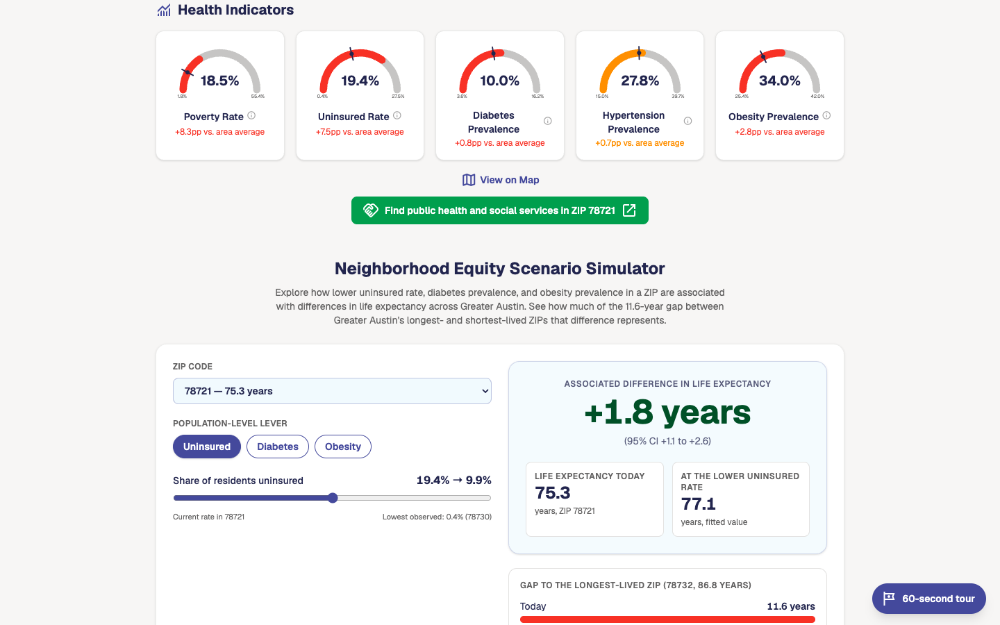
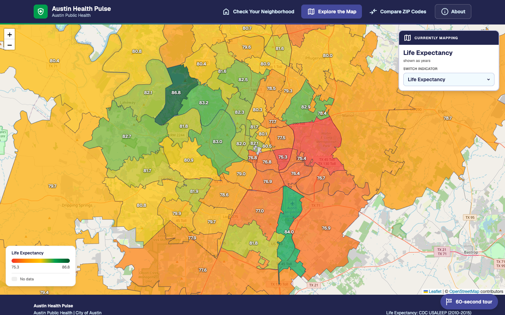
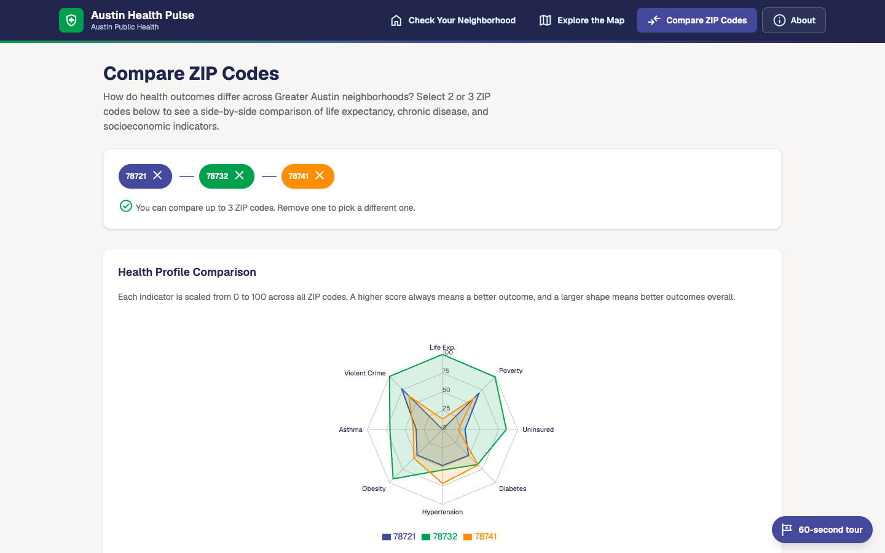
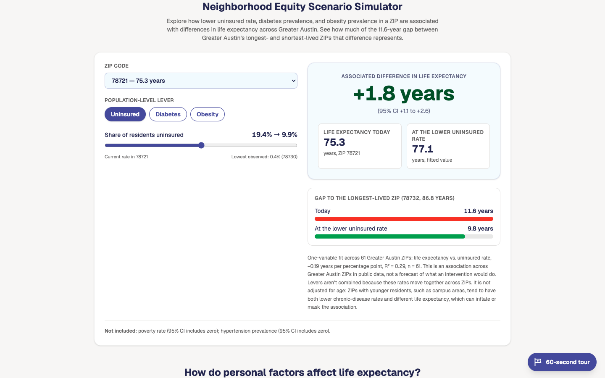
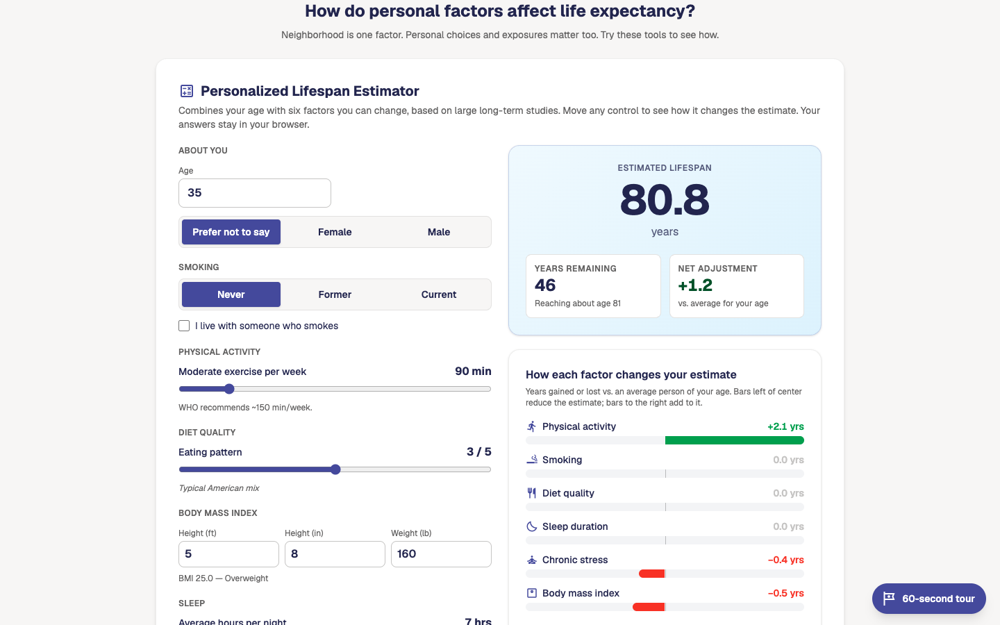
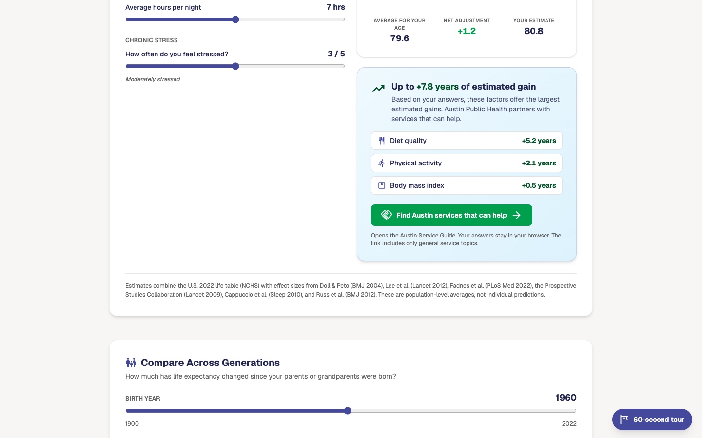

<h1 align="center">Austin Health Pulse</h1>

<p align="center">
  <strong>Life Expectancy & Health Indicator Explorer for Greater Austin</strong>
</p>

<p align="center">
  <a href="https://coa-chrisc.github.io/austin-health-pulse/">
    
  </a>
</p>

<p align="center">
  An interactive public health data tool that lets Austin residents and policymakers explore health outcomes across <strong>63 ZIP codes</strong> in Greater Austin (Travis County and neighboring areas; see <a href="#known-limitations">known limitations</a>). City settings live in a configuration file, so another city can be added without code changes.
</p>

---

## Built rapidly with AI assistance

This entire prototype (Python data pipeline, three interactive modes, choropleth map, comparison views, gauge charts, calculators, kiosk showcase, and deploy pipeline) was built by **Austin Public Health (APH) IT staff in approximately 12 hours of internal development time** (three four-hour sessions) using AI coding tools (Claude Code and GitHub Copilot).

|                      | APH IT (this build) | Typical agency engagement        |
| -------------------- | ------------------- | -------------------------------- |
| **Time**             | ~12 hours           | 6–8 weeks                        |
| **Hours**            | 3 × 4-hr sessions   | 250–400 hours                    |
| **Approximate cost** | ~$1.5K loaded staff | $50K–$100K (blended $175–250/hr) |

This project demonstrates how AI-assisted development can compress data-product timelines from months to days. It lets public-sector teams prototype quickly, validate ideas with the community, and inform decisions about full production builds. See the in-app **About → How This Was Built** panel for the per-session breakdown.

---

## Implemented hardening

Hardening work done in preparation for a grant review. Everything below is in the repo today.

- **Privacy by design.** The neighborhood figures come only from aggregate public data. Nothing a visitor enters (ZIP code, location, age, or estimator answers) leaves the browser or is stored; the only browser storage is a "tour seen" flag. The optional individual lifespan estimator is a build flag: off by default in code and in Docker builds, and on in the GitHub Pages demo workflow. See [SECURITY.md](SECURITY.md#data-handling).
- **Config-driven city setup.** Branding, map, featured ZIPs, data sources, and data files come from one validated config: [`config/`](config/), schema [`city.config.schema.json`](config/city.config.schema.json). Presets: [Greater Austin / Travis County](config/presets/austin-travis-tx.json) and a [Harris County TX / Houston demo](config/presets/partner-city-demo.json) built from real pipeline output (130 ZIPs, 16.3-year life expectancy gap). The demo's branding and agency name are placeholders, not Houston Health Department's.
- **Equity Scenario Simulator** with confidence intervals and an inclusion rule; model is computed by the pipeline ([`scripts/scenario_model.py`](scripts/scenario_model.py)).
- **Data validation.** [`npm run validate:data`](app/scripts/validate-data.mjs) schema-checks configs and data, boundary coverage, and scenario model presence. Runs in [CI](.github/workflows/deploy.yml) before the build and in the Docker build.
- **Container.** Multi-stage [`Dockerfile`](Dockerfile), nginx-unprivileged as UID 101 on port 8080, with CSP and security headers ([`deploy/nginx.conf`](deploy/nginx.conf)). Built, run, and rendered locally in headless Chrome with no CSP or console errors.
- **Cloud blueprints** in [`deploy/`](deploy/README.md): AWS ECS Fargate (Terraform, not validated; Terraform was not installed), Azure Container Apps (Bicep, validated with `az bicep build`), GCP Cloud Run (YAML parse check only). None has been deployed to any cloud.
- **Disclosure of method and limits** in the footer "Methodology & Public Data" banner and in [ARCHITECTURE.md](ARCHITECTURE.md).

---

## Adapting for another city

Works today for Texas counties; other states need life-expectancy files first (see [Phase 2](#phase-2-roadmap-proposed-grant-funded)). To change the name, colors, logo, fonts, and About text, see the rebranding guide: [`docs/CUSTOMIZING.md`](docs/CUSTOMIZING.md).

```bash
cp config/presets/partner-city-demo.json config/presets/my-city.json
# edit id, agency, region, brand, map, data paths, and the "pipeline" block (state/county FIPS)
pip install -r scripts/requirements.txt
python scripts/export_frontend_json.py --preset config/presets/my-city.json
python scripts/prepare_geojson.py      --preset config/presets/my-city.json
cd app
CITY_CONFIG=presets/my-city.json npm run validate:data
CITY_CONFIG=presets/my-city.json BASE_PATH=/ npm run build
```

`CITY_CONFIG` is relative to `config/`. Output goes to `config/data/<id>/`. If `pipeline.zctas` is `null` the ZIP list is derived (ZCTAs with at least 50% of their 2010 population in the county). The Census API needs a free key: set `CENSUS_API_KEY` before running the pipeline (steps in [`data/README.md`](data/README.md#census-api-key)). Without a key the pipeline downloads the ACS 2022 summary files instead. Crime data is Austin-APD-only (`pipeline.crimeSource: "apd-austin"` or `null`).

---

## Phase 2 roadmap (proposed, grant-funded)

**Proposed, not built.** Goal: an automated federal and local data hydration pipeline that takes a county FIPS code and pulls CDC PLACES, ACS, boundaries, and life expectancy into the `config/data` files, reducing onboarding to a configuration step.

Starting point today: FIPS-driven generation already works for Texas counties when the USALEEP files are downloaded locally. Proposed work:

1. Automatic USALEEP / state vital-statistics retrieval for any state, and life expectancy data newer than USALEEP 2010–2015.
2. Pluggable local crime and other local data sources.
3. A configuration wizard.
4. Scheduled refresh with validation gates.
5. Review of the scenario-model method with epidemiologists.

---

## Known limitations

- **Region label and area averages.** The curated 63-ZIP Austin list covers Travis County and neighboring areas. Sixteen ZIP codes have under half of their population in Travis County, and 6 of those have none. The app previously labeled this region "Travis County"; it now says "Greater Austin". Area "averages" are simple unweighted means of the ZIP values, not population-weighted county figures.
- **Scenario model** is ecological and cross-sectional, and is not adjusted for age structure. For example, the best diabetes and hypertension ZIP in Austin is 78705 (student-heavy West Campus). The simulator says on screen that its fits are not age-adjusted.
- **Life expectancy** is USALEEP 2010–2015; current conditions may differ.
- The pipeline supports Texas only; crime data is Austin-only.

---

## Screenshots

| | |
| --- | --- |
|  |  |
| Check Your Neighborhood | Health indicators |
|  |  |
| Explore the Map | Compare ZIP Codes |
|  |  |
| Equity scenario simulator | Lifespan estimator (optional) |
|  |  |
| Service Guide handoff | Same app, partner-city config |

Regenerate them with `npm run screenshots` from `app/` (needs Google Chrome; see [`app/scripts/screenshots.mjs`](app/scripts/screenshots.mjs)).

## Features

### Check Your Neighborhood

Enter a ZIP code (or use geolocation) to see your neighborhood's **life expectancy at birth** alongside five key health indicators: poverty rate, uninsured rate, diabetes, hypertension, and obesity prevalence. Animated gauge charts compare each value with the Greater Austin average (a simple unweighted mean of the ZIP values). Optionally enter your age for an **age-specific remaining life expectancy** estimate.

### Disparity views

A **disparity hero card** shows the gap between the longest- and shortest-living ZIP codes in the region, with the user's ZIP in context. In Austin the gap is 11.6 years, between 78732 (86.85 years) and 78721 (75.26 years); both are majority-Travis ZIP codes. A **sorted bar strip** ranks the ZIP codes that have a life expectancy estimate (61 of the 63 in Austin), color-graded from red to green. It highlights the user's ZIP and gives a percentile-based rank summary (for example, "is number N of 61 when ranked from shortest to longest life expectancy").

### Neighborhood Equity Scenario Simulator

Pick one lever (for example uninsured rate) and slide it from the ZIP's current rate toward the best rate observed in any ZIP in the region. The tool shows the associated change in life expectancy with a 95% confidence interval, R², and n. It is labeled an association, not a forecast. Method and limits: [ARCHITECTURE.md](ARCHITECTURE.md#scenario-model).

### Compare across generations

Birth-year slider (1900–2022) over NCHS historical U.S. life expectancy, compared with the region's current average. The optional age field in the ZIP lookup indexes that ZIP's published life table.

### Individual lifespan estimator (optional build flag)

An age/sex estimator on the U.S. 2022 life table, adjusted for six modifiable factors using published effect sizes (Doll & Peto 2004, Lee 2012, Fadnes 2022, Prospective Studies Collaboration 2009, Cappuccio 2010, Russ 2012). Unlike the neighborhood figures, it asks about the individual (age, sex, and habits). It runs entirely in the browser and sends and stores nothing.

The build includes it only when `VITE_ENABLE_PERSONAL_CALCULATOR=true`:

- **Code and Docker builds:** off unless you set the flag.
- **GitHub Pages workflow:** on by default for the live Austin demo. Set the repository variable `ENABLE_PERSONAL_CALCULATOR` to `false` to turn it off.
- **When off:** its code sits in a lazy chunk that is never loaded.

### Service Guide link from ZIP views

ZIP detail views link to the companion Austin Service Guide for that ZIP when a guide URL is configured. The link carries the ZIP code. See [Service guide handoff](#service-guide-handoff).

### Explore the Map

A full interactive **choropleth map** powered by Leaflet shows how health indicators vary across Greater Austin. Switch between indicators, hover for quick stats, or click any ZIP code for a detailed breakdown.

### Compare ZIP Codes

Select 2–3 ZIP codes to compare them side by side with a **radar chart**, grouped bar charts, and a color-coded comparison table, which makes health disparities easy to see.

### 60-second guided tour

A floating tour button opens a 4-step guided walkthrough of the app's core features. The app saves a "seen" flag in localStorage (the only thing it stores). First-time visitors see a soft attention ring on the button.

### Kiosk showcase mode

After 5 minutes of inactivity (auto-disabled on screens narrower than 768px, and by adding `?kiosk=off` before the `#`, e.g. `/austin-health-pulse/?kiosk=off#/`), an animated showcase overlay rotates through four slides: title, key statistics, an auto-rotating "Did you know?" insight panel that surfaces interesting cross-indicator facts (e.g. diabetes ratios between ZIP extremes), and a closing "explore your neighborhood" call to action. It is designed for conference booths and public health events.

When the showcase starts, every view remounts and the app returns to the home screen. This clears the previous visitor's ZIP code, age, and other inputs before the next person uses the kiosk.

### About panel — methodology + build story

A modal (centered on desktop, full-screen sheet on mobile) covers data sources, methodology, and limitations. The Austin config also turns on (`showBuildStory`) a per-session **build timeline** and an **agency-cost comparison** that puts the development effort in context; other agencies' configs leave it off.

---

## Data Sources

| Indicator                | Source                                                            | Vintage   |
| ------------------------ | ----------------------------------------------------------------- | --------- |
| Life Expectancy at Birth | [CDC USALEEP](https://www.cdc.gov/nchs/nvss/usaleep/usaleep.html) | 2010–2015 |
| Poverty Rate             | ACS 5-Year Estimates                                              | 2022      |
| Uninsured Rate           | ACS 5-Year Estimates                                              | 2022      |
| Diabetes Prevalence      | [CDC PLACES](https://www.cdc.gov/places/)                         | 2025 release (2023 BRFSS data) |
| Hypertension Prevalence  | CDC PLACES                                                        | 2025 release (2023 BRFSS data) |
| Obesity Prevalence       | CDC PLACES                                                        | 2025 release (2023 BRFSS data) |
| Current Asthma           | CDC PLACES                                                        | 2025 release (2023 BRFSS data) |
| Violent Crime Rate       | [City of Austin Open Data](https://data.austintexas.gov/) (APD Crime Reports, UCR Part 1 violent, per 1,000 residents) | Rolling 12 months at export time |

The pipeline aggregates tract-level life expectancy to ZIP code (ZCTA) level using **population-weighted averages** from the Census 2010 ZCTA-to-tract relationship file. The area averages shown in the app are simple, unweighted means of the ZIP values. Violent crime covers APD's jurisdiction only; ZIPs outside it show no data. See [`data/README.md`](data/README.md) for details.

---

## Tech Stack

| Layer      | Technology                  |
| ---------- | --------------------------- |
| Framework  | React 19 + TypeScript 5.9   |
| Build      | Vite 8                      |
| Styling    | Tailwind CSS 4.2            |
| Routing    | React Router 7 (HashRouter) |
| Maps       | Leaflet + React Leaflet     |
| Charts     | Recharts                    |
| Tests      | Vitest                      |
| Font       | Configurable via `theme.typography` (Geist by default; bundled, `@fontsource`) |
| Icons      | Material Symbols (bundled)  |
| Deployment | GitHub Pages via Actions    |

---

## Getting Started

### Prerequisites

- Node.js 22.12+
- npm 10+

### Install & Run

```bash
cd app
npm ci
npm run dev
```

The app will be available at `http://localhost:5173/austin-health-pulse/`.

### Checks

```bash
npm run lint
npm test               # Vitest tests (lifespan model, scenario simulator logic and component, service guide, formatters, error boundary)
npm run validate:data  # schema + data checks for the active config (add -- --all for every preset)
npm run build          # type-check + production build into app/dist
```

### Build for Production

```bash
cd app
npm run build
npm run preview  # serves app/dist at http://localhost:4173/austin-health-pulse/
```

Build-time settings: `CITY_CONFIG` (config file relative to `config/`, default `city.config.json`), `BASE_PATH` (default `/austin-health-pulse/`), `VITE_SERVICE_GUIDE_URL`, `VITE_ENABLE_PERSONAL_CALCULATOR`. `CITY_CONFIG` and `BASE_PATH` must be set as shell environment variables; `VITE_SERVICE_GUIDE_URL` and `VITE_ENABLE_PERSONAL_CALCULATOR` can also go in `app/.env.local` (see [`app/.env.example`](app/.env.example)).

### Service guide handoff

ZIP views link to the companion Austin Service Guide at `<serviceGuideUrl>/services?zip=<ZIP>`. The URL comes from `serviceGuideUrl` in the city config; `VITE_SERVICE_GUIDE_URL` (see [`app/.env.example`](app/.env.example)) overrides it.

- `npm run dev` falls back to `http://localhost:5173` when neither is set.
- A production build with neither hides the links instead of pointing at localhost.
- The estimator's `/intake?event=healthspan&focus=<categories>` handoff exists only when the estimator flag is on. It sends general service-topic names, never the answers entered.

### Deploying to GitHub Pages

`.github/workflows/deploy.yml` lints, tests, validates data (`validate:data -- --all`), builds, and deploys on every push to `main`. To turn it on:

1. In **Settings > Pages**, set **Source** to **GitHub Actions**.
2. Optionally, add repository variables under **Settings > Secrets and variables > Actions > Variables**. The workflow passes them to the build as `VITE_SERVICE_GUIDE_URL` and `VITE_ENABLE_PERSONAL_CALCULATOR`:
   - `SERVICE_GUIDE_URL`: the URL of the hosted Service Guide.
   - `ENABLE_PERSONAL_CALCULATOR`: the workflow treats an unset variable as `true`, so the live demo includes the individual estimator. Set it to `false` to remove the estimator.

The site is served from `/austin-health-pulse/` (the `base` in `app/vite.config.ts`). If you fork under a different repository name, set `BASE_PATH: /<repo-name>/` in the workflow's Build step env (or change the default in `app/vite.config.ts`), or assets will 404. Routing uses `HashRouter`, so deep links such as `#/compare` survive a refresh without a 404 fallback page.

Containers and cloud blueprints (AWS, Azure, GCP): see [`deploy/README.md`](deploy/README.md). Quick local run: `docker compose up --build`, then open http://localhost:8080/.

---

## Data Pipeline

Precomputed data is committed under `config/data/<id>/`, so you only need the pipeline to refresh or add a city.

Before the first run, [get a free Census API key](data/README.md#census-api-key) and run `export CENSUS_API_KEY=<your-key>` in your shell. The app build and CI do not need the key. Without it, the export downloads about 260 MB of ACS summary files instead (slower, same values).

Run from the repo root (Python 3.10 or later):

```bash
pip install -r scripts/requirements.txt
python scripts/export_frontend_json.py [--preset config/presets/<id>.json] [--model-only]
python scripts/prepare_geojson.py      [--preset config/presets/<id>.json]
```

`--preset` defaults to `config/city.config.json`. `--model-only` recomputes only the `scenarioModel` block from the existing indicators file, with no network access.

| Script                              | Purpose                                                                                                      |
| ----------------------------------- | ------------------------------------------------------------------------------------------------------------ |
| `export_frontend_json.py`           | Reads USALEEP CSVs from `data/raw/`, pulls ACS, CDC PLACES, and (Austin) APD crime, aggregates to ZCTA, writes `zip-indicators.json` and `county-summary.json` |
| `prepare_geojson.py`                | Downloads Census ZCTA boundaries, filters to the preset's ZIPs, simplifies geometry, writes `boundaries.geojson` |
| `scenario_model.py`                 | Per-indicator regression used for the simulator (called by the export script)                                |
| `pipeline_preset.py`, `acs_summary_file.py` | Preset loading; keyless ACS fallback                                                                 |
| `travis_county_health_data_pull.py` | Original standalone ArcGIS CSV pull; not used by the app                                                     |

Sources, pipeline order, and known data gaps are in [`data/README.md`](data/README.md).

---

## Project Structure

```
├── app/
│   ├── plugins/               # Vite plugin serving virtual:city-config
│   ├── scripts/               # validate-data.mjs, screenshots.mjs
│   ├── src/
│   │   ├── components/        # neighborhood, scenario, lifespan (optional), explore,
│   │   │                      # compare, layout, shared, showcase
│   │   ├── hooks/             # Data context, idle timer, animated numbers
│   │   ├── lib/               # City config, equity scenario, service guide, data loader, models
│   │   └── types/
│   ├── .env.example           # Build-time settings
│   └── vite.config.ts
├── config/
│   ├── city.config.json       # Active city config
│   ├── presets/               # austin-travis-tx, partner-city-demo (Harris TX)
│   ├── brand/<id>/            # Logo files referenced by brand.logoUrl
│   ├── data/<id>/             # zip-indicators, boundaries, county-summary per city
│   └── *.schema.json
├── data/raw/                  # USALEEP source CSVs (see data/README.md)
├── deploy/                    # nginx.conf + AWS / Azure / GCP blueprints
├── docs/                      # CUSTOMIZING.md (rebranding guide), screenshots/
├── scripts/                   # Python data pipeline
├── Dockerfile, docker-compose.yml
├── .github/workflows/         # CI + GitHub Pages deployment
├── ARCHITECTURE.md, SECURITY.md, CONTRIBUTING.md
├── LICENSE                    # Apache 2.0
└── README.md
```

---

## Methodology Notes

- Life expectancy estimates are **statistical estimates**, not individual predictions
- Within-ZIP variation can be significant — these are area-level averages
- CDC PLACES indicators use model-based small area estimation from BRFSS survey data
- USALEEP data reflects 2010–2015 mortality patterns; current conditions may differ
- Scenario results are associations across ZIPs, not causal effects or forecasts

---

## Contributing & License

See [CONTRIBUTING.md](CONTRIBUTING.md). To report a vulnerability, see [SECURITY.md](SECURITY.md). Licensed under the [Apache License 2.0](LICENSE).

---

<p align="center">
  Built for <strong>Austin Public Health</strong> — City of Austin, Texas<br/>
  <sub>Promoting health equity through data transparency</sub>
</p>
