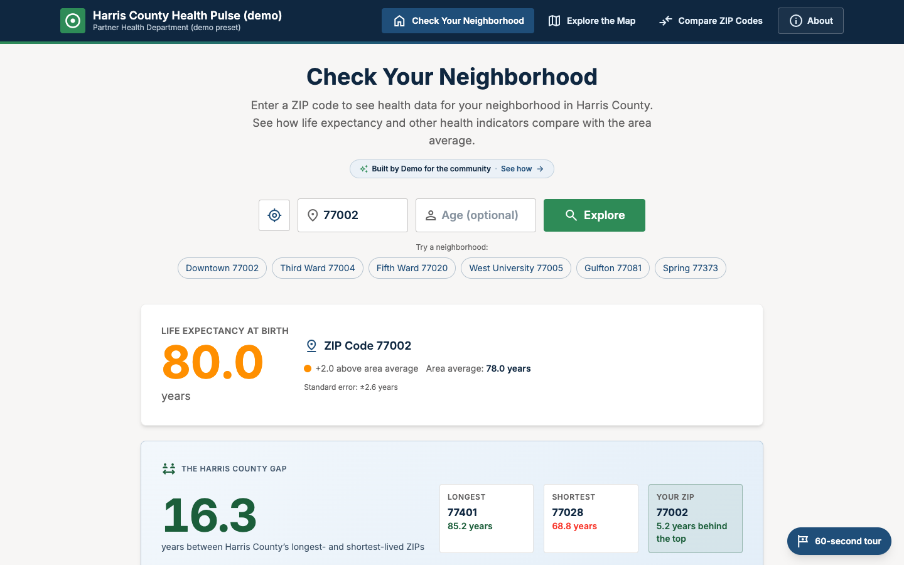

# Rebranding for your agency

Everything an agency normally changes lives in one city config file. You don't need to edit any components.



## 1. Start from a preset

```bash
cp config/presets/partner-city-demo.json config/presets/my-city.json
```

Edit the copy, then build with it:

```bash
cd app
CITY_CONFIG=presets/my-city.json npm run validate:data
CITY_CONFIG=presets/my-city.json npm run dev       # live preview; reloads when the config changes
```

The config is checked against [`config/city.config.schema.json`](../config/city.config.schema.json) when you build. Editors that support JSON Schema, such as VS Code, autocomplete and flag errors as you type because of the `$schema` line at the top of each preset.

To make your config the default, copy it over `config/city.config.json`.

## 2. Names and text

| Key | Where it shows |
| --- | --- |
| `appName` | Header, browser tab title, page description, About panel, idle showcase |
| `agency.name`, `agency.shortName`, `agency.parent` | Header subtitle, footer, About panel credits, "Built by …" badge |
| `region.name` | Used as a proper noun throughout, for example "across Harris County" and "the Harris County average". Name the area your ZIP codes actually cover. |
| `region.cityName` | Service Guide buttons and text ("Find Houston services that can help") |
| `featuredZips` | The "Try a neighborhood" buttons on the home page |
| `dataSources`, `dataAsOf` | Footer and About panel |
| `serviceGuideUrl` | Base URL for the Service Guide links. Set it to `null` to hide them. |
| `showBuildStory` | Shows the About panel's "How This Was Built" section, which is the City of Austin's build story with its own hours and costs. Leave it out or set it to `false` for your agency. |

## 3. Colors

`theme.colors` sets 18 colors by role. Every key is required and must be a six-digit hex value such as `#44499C`.

| Key | Where it shows |
| --- | --- |
| `primary` | Active navigation, buttons, links, section headings, slider fills |
| `primarySoft` | Tinted panels and soft gradients |
| `accent` | Logo tile, "Explore" button, browser-tab icon, highlights |
| `accentSoft` | Tinted accent backgrounds |
| `ink` | Header and footer background, headings, large numbers |
| `onBrand` | Text and icons on `primary`, `ink`, `accent`, and `positiveFill` |
| `page` | Page background |
| `surface` | Cards, popovers, tooltips |
| `subtle` | Progress tracks and empty slots |
| `body` | Body text |
| `muted` | Secondary text |
| `line` | Borders and dividers |
| `noData` | Map and chart fill for missing data |
| `positive` | Text and numbers that mean "better" |
| `positiveFill` | Bars and fills that mean "better" |
| `negative` | Text and fills that mean "worse"; errors |
| `warning` | Caution icons |
| `scrim` | Backdrop behind modals and overlays (used at 20 to 60 percent opacity) |

Two more lists sit next to `colors`:

- **`dataScale`** is exactly five colors, ordered worst to best. The map, the bar strip, gauges, and comparison table highlights run along it. Choose any five colors you like, such as a blue-to-orange scale, as long as the first reads as worst and the last as best.
- **`series`** is 3 to 8 colors used in order for the lines, bars, and radar in Compare mode, one per ZIP code selected.

Check contrast yourself or let `validate:data` do it. It prints a warning (not an error) for each of these pairs that falls below WCAG AA:

- `body` on `page` and `surface`; `muted` on `page` and `surface`
- `ink` on `page` and `primarySoft`
- `primary`, `positive`, and `negative` on `surface` (4.5:1)
- `onBrand` on `primary`, `ink`, `accent`, and `positiveFill` (4.5:1)
- `warning` on `surface` (3:1, because it is used for icons)

How it works: the build writes your theme into one `<style id="theme">` element in the page `<head>`, so the page never shows default values first. That element holds the color variables, the font, the text sizes, and the corner radii.

## 4. Logo and browser-tab icon

Put your logo under `config/brand/<your-id>/` and point `brand.logoUrl` at it, relative to `config/`:

```json
"brand": { "logoUrl": "brand/my-city/logo.svg" }
```

- **Format:** SVG, PNG, or WebP.
- **Where it shows:** in a 40-pixel tile filled with `accent` in the header, so a white or light mark works best.
- **How it's served:** the build bundles the file with the app, so it is served from your own site and passes the Content-Security-Policy. Logos hosted elsewhere are not supported.
- **When it's `null`:** a health-and-safety icon appears instead.
- **Checks:** `validate:data` and the build both fail if the file is missing.

The browser-tab icon is generated from your `accent`: a rounded square with a white plus.

## 5. Fonts

The app uses one text font and the Material Symbols icon font. Both are bundled with the app through `@fontsource` packages, so the browser contacts no font service. The icon font is fixed.

To change the text font:

1. Run `npm install @fontsource/<font>` in `app/`.
2. Set `theme.typography` in your config:

```json
"typography": {
  "fontPackage": "@fontsource/inter",
  "family": "Inter",
  "fallback": "Helvetica, Arial, sans-serif",
  "baseSize": 16,
  "sizes": {}
}
```

| Key | Meaning |
| --- | --- |
| `fontPackage` | The installed `@fontsource` package |
| `family` | The CSS font name the package defines |
| `fallback` | Fonts to use while it loads or if it fails |

The build loads the Latin subset at weights 400, 500, 600, and 700 automatically. The package must provide all four. `validate:data` and the build fail if the package is not installed or a weight is missing.

Don't load fonts from a third-party host. The Content-Security-Policy in `deploy/nginx.conf` blocks them, and loading them would tell that host about every visitor.

## Sizes

`baseSize` (12 to 24, default 16) scales all text and spacing, because both are sized in `rem`. The build applies it to `<html>` as a percentage (16 becomes 100%), so a visitor's browser text-size setting still works.

`sizes` overrides single text steps. Values are `rem`, from 0.5 to 6. Leave it as `{}` to keep the defaults.

| Step | Default (rem) | Step | Default (rem) |
| --- | --- | --- | --- |
| `3xs` | 0.625 | `2xl` | 1.5 |
| `2xs` | 0.6875 | `3xl` | 1.875 |
| `xs` | 0.75 | `4xl` | 2.25 |
| `sm` | 0.875 | `5xl` | 3 |
| `base` | 1 | `6xl` | 3.75 |
| `lg` | 1.125 | `7xl` | 4.5 |
| `xl` | 1.25 | | |

## Radius

`theme.radius` sets four corner sizes, each a `rem` or `px` value such as `0.5rem`:

| Key | Used for |
| --- | --- |
| `chip` | Small tags and badges |
| `control` | Buttons and inputs |
| `card` | Cards |
| `panel` | Large panels and dialogs |

Set them all to `0rem` to get square corners. The Harris County demo uses smaller values than Austin to show the difference.

## For developers

When you add UI, use the theme instead of literal values:

- Tailwind role utilities: `bg-primary`, `text-muted`, `border-line`, `rounded-card`, `text-2xs`.
- In TypeScript (charts, inline styles): `THEME`, `fontSize()`, and `FONT_FAMILY` from `app/src/lib/theme.ts`.

`themeGuard.test.ts` fails on hex or `rgb()` literals, Tailwind palette colors, arbitrary text sizes such as `text-[11px]`, Tailwind radius classes such as `rounded-lg`, and literal font sizes or families. For a rare exception, add a `theme-exempt: <reason>` comment on the same line.

## 6. Map

`map.center` (`[lat, lng]`), `zoom`, `minZoom`, and `maxZoom` set the starting view. Map tiles come from OpenStreetMap's public tile server. For a kiosk or a high-traffic site, read the [OpenStreetMap tile usage policy](https://operations.osmfoundation.org/policies/tiles/) and consider your own tile provider. If you switch providers, update the tile URL in `app/src/lib/constants.ts` and `img-src` in `deploy/nginx.conf`.

## 7. Check your work

```bash
cd app
CITY_CONFIG=presets/my-city.json npm run validate:data
CITY_CONFIG=presets/my-city.json BASE_PATH=/ npm run build
npm run screenshots   # regenerates docs/screenshots; needs Google Chrome (set CHROME_PATH if it isn't in the macOS default location)
```

The City of Austin and Austin Public Health names, logos, and palette identify the City. The Apache-2.0 license covers the code, not those marks, so replace them in your deployment.
